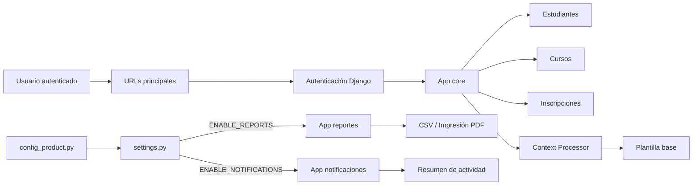
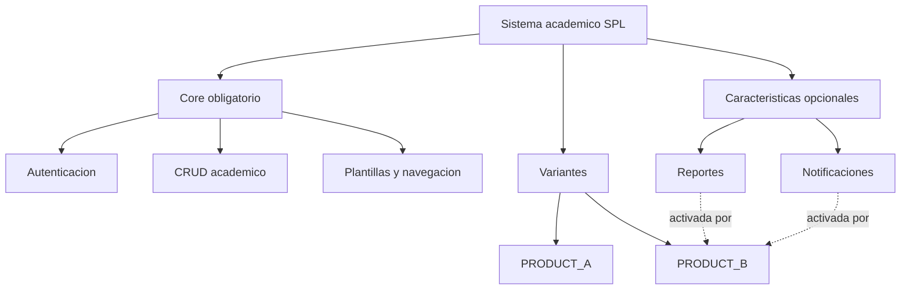

# INFORME Y MANUAL TECNICO SPL

## Desarrollo - Sesión 1 (Identificación de componentes)

La línea de productos se organizó alrededor de un núcleo académico y dos funcionalidades opcionales independientes. El núcleo contiene autenticación, usuarios, modelos, formularios, vistas, plantillas y utilidades básicas. Las extensiones no alteran las entidades principales y pueden excluirse mediante configuración.

| Componentes reutilizables (Core Assets) | Componentes específicos u opcionales |
|---|---|
| Django autentica usuarios y protege las vistas con `login_required`. | Generación de reportes en CSV y vista imprimible para PDF. |
| CRUD de estudiantes, cursos e inscripciones. | Panel de notificaciones académicas. |
| Modelos `Estudiante`, `Curso` e `Inscripcion`. | Menú, rutas y plantillas propias de `reportes`. |
| Plantillas base, navegación, Bootstrap y context processor. | Menú, rutas y plantillas propias de `notificaciones`. |
| Configuración central de base de datos, sesiones y migraciones. | Exportaciones y mensajes solamente presentes en la variante Enterprise. |
| Formularios y modelos reutilizables para futuros productos académicos. | Métricas alternativas o integraciones externas no incluidas en el núcleo. |

### Diagrama de arquitectura funcional



## Desarrollo - Sesión 2 (Modularización)

La app `core` contiene el dominio común de gestión académica. Las aplicaciones `reportes` y `notificaciones` fueron creadas con `python manage.py startapp` y no modifican ni heredan modelos del núcleo; solamente consultan los datos necesarios. Esta separación permite mantener intacta la funcionalidad básica si una función opcional se desactiva.

El registro de apps se realiza dinámicamente en `settings.py`:

```python
from .config_product import ACTIVE_VARIANT, VARIANTS

ACTIVE_PRODUCT = VARIANTS[ACTIVE_VARIANT]
ACTIVE_VARIANT_NAME = ACTIVE_VARIANT
ENABLE_REPORTS = ACTIVE_PRODUCT['ENABLE_REPORTS']
ENABLE_NOTIFICATIONS = ACTIVE_PRODUCT['ENABLE_NOTIFICATIONS']
PRODUCT_NAME = ACTIVE_PRODUCT['PRODUCT_NAME']

if ENABLE_REPORTS:
    INSTALLED_APPS.append('reportes')
if ENABLE_NOTIFICATIONS:
    INSTALLED_APPS.append('notificaciones')
```

Las vistas opcionales están protegidas y consultan datos del núcleo sin acoplamiento directo:

```python
@login_required
def estudiantes_csv(request):
    response = HttpResponse(content_type='text/csv; charset=utf-8')
    response['Content-Disposition'] = 'attachment; filename="estudiantes.csv"'
    return response
```

En las plantillas, el context processor expone las banderas al menú y a las vistas principales:

```django

<li class="nav-item">
    <a class="nav-link" href="">Reportes</a>
</li>



<li class="nav-item">
    <a class="nav-link" href="">Notificaciones</a>
</li>

```

## Desarrollo - Sesión 3 (Configuración de variabilidad)

El archivo [config_product.py](gestion_academica/config_product.py) define dos variantes. `ACTIVE_VARIANT` selecciona cuál se carga al iniciar Django.

```python
PRODUCT_A = {
    'ENABLE_REPORTS': False,
    'ENABLE_NOTIFICATIONS': False,
    'PRODUCT_NAME': 'Sistema Base (Edicion Estandar)',
}

PRODUCT_B = {
    'ENABLE_REPORTS': True,
    'ENABLE_NOTIFICATIONS': True,
    'PRODUCT_NAME': 'Sistema Full (Edicion Enterprise)',
}

ACTIVE_VARIANT = 'PRODUCT_B'
```

El registro de rutas también depende de las banderas:

```python
if settings.ENABLE_REPORTS:
    urlpatterns.append(path('reportes/', include('reportes.urls')))
if settings.ENABLE_NOTIFICATIONS:
    urlpatterns.append(path('notificaciones/', include('notificaciones.urls')))
```

Al cambiar `ACTIVE_VARIANT`, Django reinicia su configuración al ejecutar nuevamente el servidor. Las migraciones del núcleo no cambian entre variantes porque las aplicaciones opcionales no poseen modelos propios.

### Espacio para evidencias visuales

**[PEGAR AQUÍ CAPTURA VARIANTE A]**

**[PEGAR AQUÍ CAPTURA VARIANTE B]**

## Desarrollo - Sesión 4 y Manual "Línea de productos basada en Django"

### Análisis SPL

- **Core Assets:** proyecto Django, autenticación, base de datos, usuarios, modelos académicos, CRUD de estudiantes y cursos, plantilla base y navegación principal.
- **Puntos de variación:** nombre comercial, inclusión de reportes, inclusión de notificaciones y visibilidad de enlaces asociados.
- **Patrón aplicado:** Feature Toggles o banderas de configuración centralizadas, combinadas con `INSTALLED_APPS` dinámico e inclusión condicional de URLs.
- **Producto derivado A:** contiene el núcleo sin funciones opcionales.
- **Producto derivado B:** contiene el núcleo y activa reportes y notificaciones.

### Modelo de características



### Tabla de variantes y configuración

| Configuración | PRODUCT_A | PRODUCT_B |
|---|---|---|
| Nombre | Sistema Base (Edicion Estandar) | Sistema Full (Edicion Enterprise) |
| `ENABLE_REPORTS` | `False` | `True` |
| `ENABLE_NOTIFICATIONS` | `False` | `True` |
| App `reportes` en `INSTALLED_APPS` | No | Sí |
| App `notificaciones` en `INSTALLED_APPS` | No | Sí |
| Ruta `/reportes/` | No existe | Disponible |
| Ruta `/notificaciones/` | No existe | Disponible |
| Menú Reportes | Oculto | Visible |
| Menú Notificaciones | Oculto | Visible |

### Manual de uso

1. Abra una terminal en la carpeta del proyecto: `C:\Users\Eduardo\Desktop\Dw\1`.
2. Instale las dependencias: `python -m pip install -r requirements.txt`.
3. Cree o actualice la base de datos: `python manage.py migrate`.
4. Cree un usuario administrador si no desea utilizar el demo: `python manage.py createsuperuser`.
5. Use la cuenta de demostración preparada: usuario `demo` y contraseña `Demo12345!`.
6. Abra [config_product.py](gestion_academica/config_product.py).
7. Para activar la Variante A, cambie `ACTIVE_VARIANT = 'PRODUCT_A'`.
8. Para activar la Variante B, cambie `ACTIVE_VARIANT = 'PRODUCT_B'`.
9. Detenga el servidor si está iniciado y ejecute `python manage.py check`.
10. Inicie el servidor: `python manage.py runserver`.
11. Abra `http://localhost:8000/login/`, ingrese las credenciales y acceda al dashboard.

### URLs para capturas

**Variante A — activar `PRODUCT_A`:**

- Login: `http://localhost:8000/login/`
- Dashboard: `http://localhost:8000/`
- Estudiantes: `http://localhost:8000/estudiantes/`
- Cursos: `http://localhost:8000/cursos/`
- Ruta deshabilitada que debe fallar: `http://localhost:8000/reportes/`
- Ruta deshabilitada que debe fallar: `http://localhost:8000/notificaciones/`

Tomar una captura del dashboard sin los enlaces Reportes y Notificaciones. Luego comprobar que las rutas directas no están registradas.

**Variante B — activar `PRODUCT_B`:**

- Login: `http://localhost:8000/login/`
- Dashboard: `http://localhost:8000/`
- Estudiantes: `http://localhost:8000/estudiantes/`
- Cursos: `http://localhost:8000/cursos/`
- Reportes: `http://localhost:8000/reportes/`
- CSV: `http://localhost:8000/reportes/estudiantes/csv/`
- Vista imprimible para PDF: `http://localhost:8000/reportes/estudiantes/pdf/`
- Notificaciones: `http://localhost:8000/notificaciones/`

Tomar una captura del dashboard con los enlaces Reportes y Notificaciones y otra captura del panel de reportes.

### Recomendaciones para reutilizar apps entre proyectos Django

- Mantener cada app independiente de URLs, plantillas y configuraciones de otras apps.
- Usar nombres únicos para evitar conflictos de rutas y nombres de templates.
- Declarar dependencias explícitas y proporcionar datos vacíos o valores predeterminados.
- Registrar apps opcionales mediante banderas centralizadas.
- Exponer banderas por medio de context processors solo después de validar su existencia en `settings.py`.
- Mantener versiones compatibles de Django en `requirements.txt`.
- Ejecutar migraciones y pruebas con todas las variantes antes de publicar una versión.

## Resultados

Se obtuvo un proyecto Django funcional con autenticación, panel académico, CRUD completo de estudiantes y cursos, estructura modular y dos variantes de producto configurables. La Variante A mantiene únicamente el núcleo y oculta reportes y notificaciones. La Variante B registra ambas apps, habilita sus rutas y muestra los enlaces en el menú. El context processor impide que las plantillas dependen de variables inexistentes y mantiene una interfaz consistente.

Se verificaron las dos variantes con `python manage.py check`, `python manage.py makemigrations --check`, `python manage.py migrate --plan` y `python manage.py showmigrations core`. El proyecto no presenta errores de migración ni de rutas en ninguna variante. También se ejecutaron tres pruebas de autenticación y CRUD con resultado satisfactorio.

Herramientas utilizadas: Python, Django, SQLite, Django Authentication, Django Templates, Bootstrap, CSV, context processors, feature flags, arquitectura modular, Mermaid y Markdown.

## Conclusiones y Recomendaciones

### Conclusiones

1. La separación entre el núcleo académico y las apps opcionales permite derivar productos sin duplicar el código común ni modificar sus modelos principales.
2. Las feature flags de `config_product.py` controlan simultáneamente apps instaladas, rutas disponibles, nombre comercial y elementos visibles de la interfaz.
3. La verificación con Django demuestra que las variantes pueden cambiar sin generar cambios de migración ni romper la resolución de rutas.

### Recomendaciones

1. Centralizar las banderas en un módulo de configuración y validar explícitamente los nombres de variantes para evitar configuraciones inválidas.
2. Incorporar pruebas automatizadas para cada combinación de banderas, especialmente la disponibilidad de rutas y la navegación condicional.
3. Documentar y versionar los productos derivados junto con sus banderas, de modo que las entregas puedan reproducirse sin depender de cambios manuales de código.
